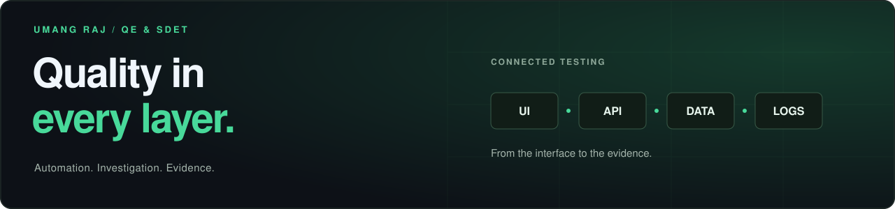

# Umang Raj

**Quality Engineer & SDET at LTIMindtree · Bengaluru, India**

I build and maintain automation across application interfaces, APIs and end-to-end workflows. My work connects what happens in the browser with the evidence in network responses, databases and logs.

**[Portfolio](https://uraj07-portfolio.vercel.app)** &nbsp; · &nbsp; **[LinkedIn](https://www.linkedin.com/in/umang-raj-bb90a2124/)**

## Quality across the whole flow

- **UI automation:** Playwright, Selenium, Java and TypeScript; BDD and hybrid testing frameworks with Cucumber and TestNG.
- **API and data validation:** Trigger service endpoints through the application UI, validate network requests and responses, and check databases and Splunk logs.
- **AI agent orchestration:** Built an AI agent to orchestrate an end-to-end testing flow for client API services, spanning Postman, database checks, Splunk and the application UI.
- **Test suites and delivery:** Created Postman suites for endpoints across services and integrated automated tests into GitLab CI/CD.

## Featured QE projects

### [AI Test Failure Triage](https://github.com/UR07/ai-qe-triage)

A local Python prototype that classifies failure symptoms from test logs and JUnit XML, extracts evidence and suggests an investigation step. Includes optional Ollama explanations. Evaluated on **synthetic examples**; predictions are hypotheses rather than confirmed root causes.

`Python` · `scikit-learn` · `JUnit XML` · `Ollama integration`

### [Mayors BDD Automation](https://github.com/UR07/BDD-FrameWork-Mayors-Auromation)

Browser automation with Gherkin scenarios, Cucumber step definitions, page objects and reusable test utilities. Includes reporting and screenshot helpers for investigating failures.

`Java` · `Selenium` · `Cucumber` · `JUnit` · `Maven`

### [Mayors Selenium & TestNG Suite](https://github.com/UR07/Automation-Testing-)

A complementary UI testing suite with page objects, TestNG runners, browser setup and teardown, assertions and ExtentReports integration.

`Java` · `Selenium` · `TestNG` · `ExtentReports`

## Testing toolkit

| Area | Tools and practices |
| --- | --- |
| UI automation | Playwright, Selenium, Cucumber, TestNG, BDD, page objects |
| APIs and data | Postman, REST APIs, SoapUI, JMeter, MySQL, Oracle SQL Developer |
| Languages | Java, TypeScript, JavaScript, Python, SQL |
| Delivery and investigation | GitLab CI/CD, Git, GitHub, Splunk, Jira, Docker, AWS, Linux |
| AI-assisted engineering | AI agent orchestration, GitHub Copilot |

---

Explore my [portfolio](https://uraj07-portfolio.vercel.app) for experience and projects, or connect on [LinkedIn](https://www.linkedin.com/in/umang-raj-bb90a2124/).
