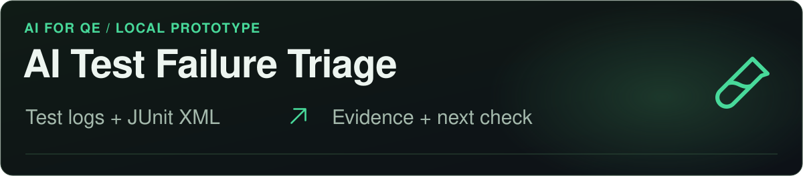

<picture>
  <source media="(max-width: 600px)" srcset="./assets/profile-hero-mobile.svg" />
  
</picture>

# Umang Raj

**Quality Engineer & SDET at LTIMindtree · Bengaluru, India**

I build and maintain automation across application interfaces, APIs and end-to-end workflows. My work connects what happens in the browser with the evidence in network responses, databases and logs.

  
  &nbsp;
  

[My work](#quality-across-the-whole-flow) &nbsp; / &nbsp; [QE projects](#featured-qe-projects) &nbsp; / &nbsp; [Toolkit](#testing-toolkit)

## Quality across the whole flow

<strong>UI automation</strong> / Playwright, Selenium and BDD

Playwright, Selenium, Java and TypeScript; BDD and hybrid testing frameworks with Cucumber and TestNG.

<strong>API and data validation</strong> / From network responses to Splunk

Trigger service endpoints through the application UI, validate network requests and responses, and check databases and Splunk logs.

<strong>AI agent orchestration</strong> / One connected testing flow

Built an AI agent to orchestrate an end-to-end testing flow for client API services, spanning Postman, database checks, Splunk and the application UI.

<strong>Test suites and delivery</strong> / Postman and CI/CD

Created Postman suites for endpoints across services and integrated automated tests into GitLab CI/CD.

## Featured QE projects

### [AI Test Failure Triage](https://github.com/UR07/ai-qe-triage)

A local Python prototype that classifies failure symptoms from test logs and JUnit XML, extracts evidence and suggests an investigation step. Includes optional Ollama explanations. Evaluated on **synthetic examples**; predictions are hypotheses rather than confirmed root causes.

`Python` · `scikit-learn` · `JUnit XML` · `Ollama integration`

### [Mayors BDD Automation](https://github.com/UR07/BDD-FrameWork-Mayors-Auromation)

<strong>Explore the BDD framework</strong>

Browser automation with Gherkin scenarios, Cucumber step definitions, page objects and reusable test utilities. Includes reporting and screenshot helpers for investigating failures.

`Java` · `Selenium` · `Cucumber` · `JUnit` · `Maven`

### [Mayors Selenium & TestNG Suite](https://github.com/UR07/Automation-Testing-)

<strong>Explore the TestNG suite</strong>

A complementary UI testing suite with page objects, TestNG runners, browser setup and teardown, assertions and ExtentReports integration.

`Java` · `Selenium` · `TestNG` · `ExtentReports`

## Testing toolkit

<strong>Open the full toolkit</strong> / Automation, APIs, data, delivery and AI

| Area | Tools and practices |
| --- | --- |
| UI automation | Playwright, Selenium, Cucumber, TestNG, BDD, page objects |
| APIs and data | Postman, REST APIs, SoapUI, JMeter, MySQL, Oracle SQL Developer |
| Languages | Java, TypeScript, JavaScript, Python, SQL |
| Delivery and investigation | GitLab CI/CD, Git, GitHub, Splunk, Jira, Docker, AWS, Linux |
| AI-assisted engineering | AI agent orchestration, GitHub Copilot |

---

Explore my [portfolio](https://uraj07-portfolio.vercel.app) for experience and projects, or connect on [LinkedIn](https://www.linkedin.com/in/umang-raj-bb90a2124/).
